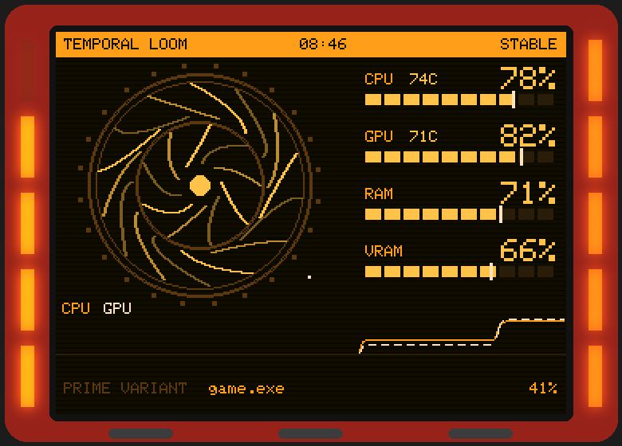
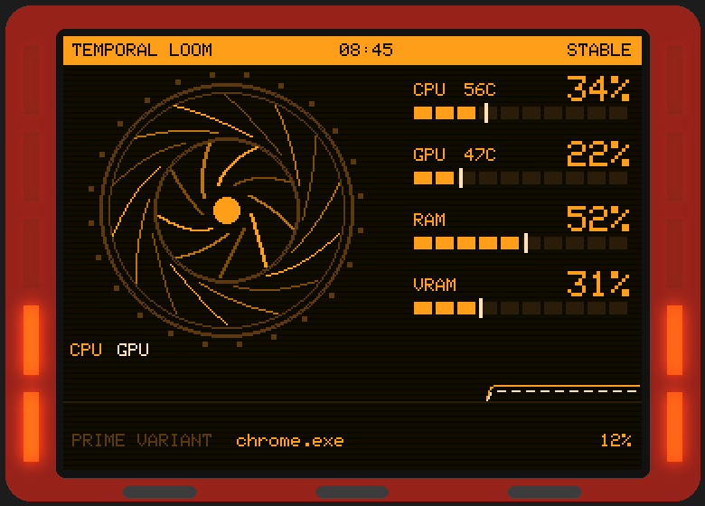
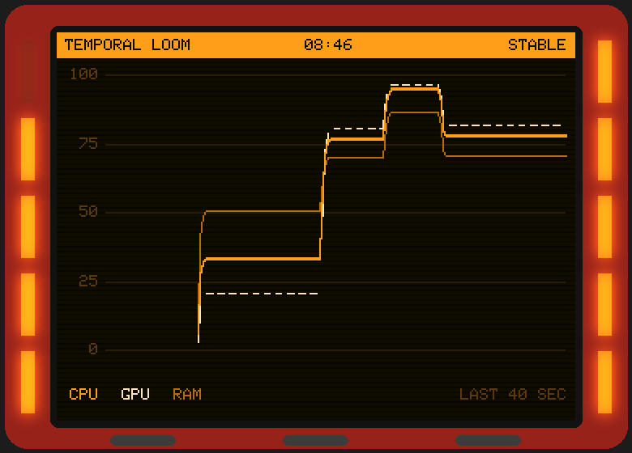
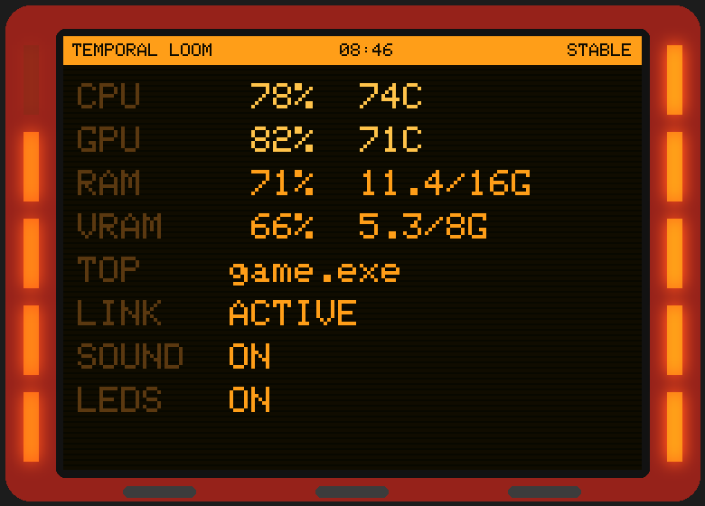
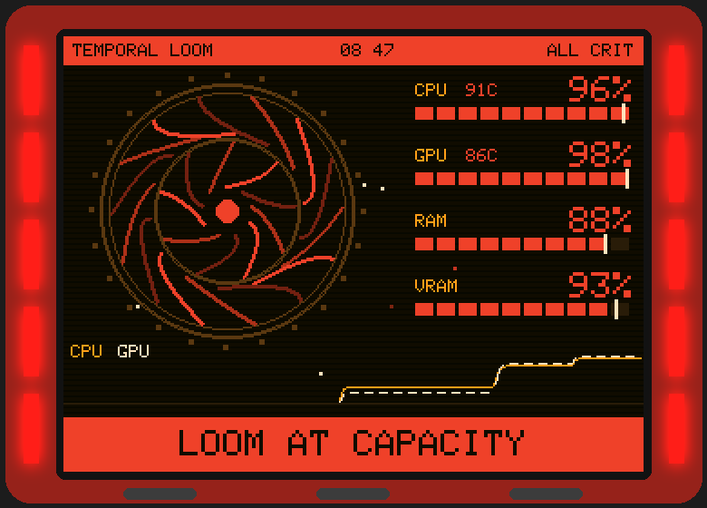
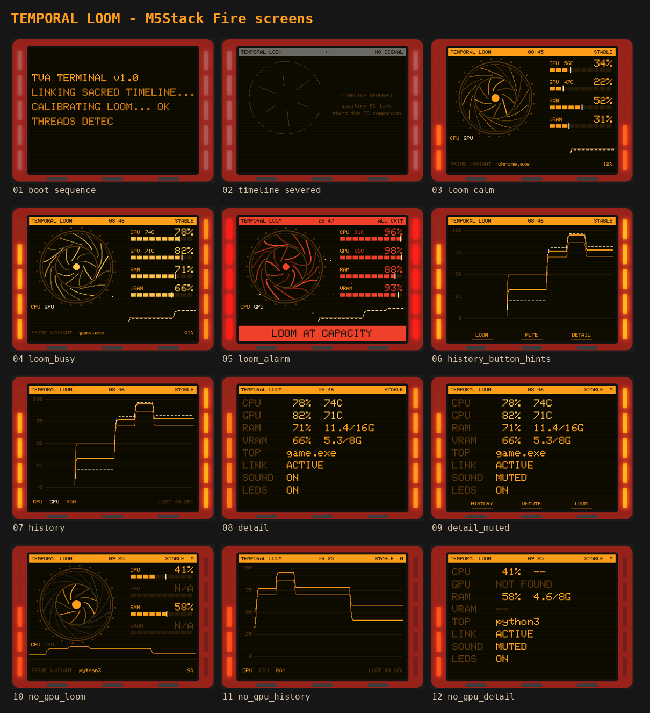

# Temporal Loom

A desk-side PC monitor for the **M5Stack Fire**, inspired by the Temporal Loom from *Loki*.
Your computer's CPU, GPU, RAM and VRAM become a spinning loom of amber threads, and an alarm fires when something runs too hot.

<p align="center">
  
</p>

## How it works

```
 Your computer                              M5Stack Fire
┌──────────────────────┐     USB cable     ┌──────────────────────┐
│ Companion app (pc/)  │ ────────────────▶ │ Firmware (firmware/) │
│ reads the sensors    │   stats, 2x / s   │ draws the loom       │
└──────────────────────┘                   └──────────────────────┘
```

You set it up in three steps: **get the code**, **flash the M5Stack** once, then **run the companion** whenever you want the display on.

## What you need

- An **M5Stack Fire** (an M5Stack Basic works too) and a USB-C cable that carries data
- **Arduino IDE 2**
- **Python 3.8 or newer** on Windows, macOS or Linux

## Step 1: Get the code

```
git clone https://github.com/RashikaKarki/temporal_loom.git
cd temporal_loom
```

Or click **Code > Download ZIP** on GitHub and unzip it.

## Step 2: Flash the M5Stack

You only need to do this once.

1. In Arduino IDE, open **File > Preferences** and add this to **Additional boards manager URLs**:
   `https://static-cdn.m5stack.com/resource/arduino/package_m5stack_index.json`
2. Open **Tools > Board > Boards Manager**, then install **M5Stack**.
3. Open **Tools > Manage Libraries**, then install **M5Unified** (accept its dependencies) and **ArduinoJson** (version 7).
4. Open `firmware/temporal_loom/temporal_loom.ino`.
5. Under **Tools**, choose these settings:
   - **Board:** M5Stack > M5Fire (or M5Core for the Basic)
   - **PSRAM:** Enabled
   - **Port:** your M5Stack
6. Click **Upload**.

When it finishes, the M5Stack shows **TIMELINE SEVERED**. That means it's waiting for your computer.

## Step 3: Run the companion

```
cd pc
pip install -r requirements.txt
python temporal_loom.py
```

On macOS and Linux, use `pip3` and `python3`. The loom starts spinning within a second, and it keeps running until you close the terminal or press **Ctrl+C**.

### Extra setup for your system

Most readings work straight away. CPU temperature and some GPUs need a little extra help:

<details>
<summary><b>Windows</b></summary>

For CPU temperature and AMD or Intel GPUs, run [LibreHardwareMonitor](https://github.com/LibreHardwareMonitor/LibreHardwareMonitor) as administrator and turn on **Options > Remote Web Server > Run**. The companion finds it automatically.

</details>

<details>
<summary><b>macOS</b></summary>

For CPU temperature on Apple Silicon (M1 and newer), install [smctemp](https://github.com/narugit/smctemp):

```
git clone https://github.com/narugit/smctemp
cd smctemp
sudo make install
```

On Intel Macs, run `brew install osx-cpu-temp` instead.

</details>

<details>
<summary><b>Linux</b></summary>

To allow access to the USB port, run this, then log out and back in:

```
sudo usermod -aG dialout $USER
```

On Arch, use the `uucp` group instead. If CPU temperature shows `--`, install `lm-sensors` and run `sudo sensors-detect`.

</details>

Run `python temporal_loom.py --sensors` to see what was detected on your computer. Anything your computer can't report shows as `--` or 0%, and everything else keeps working.

## Using it

| Button | Action |
|---|---|
| **A** (left) | Previous screen |
| **B** (middle), click | Silence the alarm, or mute and unmute all sounds |
| **B** (middle), hold | Turn the LED bars on or off |
| **C** (right) | Next screen |

| Loom | History |
|---|---|
|  |  |
| The live loom, with a meter for each reading | CPU, GPU and RAM over the last 40 seconds |
| **Detail** | **Alarm** |
|  |  |
| Exact numbers, the busiest program and status | Red threads, flashing LEDs and a double beep |

<details>
<summary>See every screen, including startup, disconnected and computers without a GPU</summary>



</details>

### When the alarm goes off

The alarm goes off when a reading stays over its limit for 3 seconds, and it beeps every 10 seconds until things calm down.

| Reading | Limit |
|---|---|
| CPU load | 85% |
| CPU temperature | 85°C |
| GPU load | 90% |
| GPU temperature | 83°C |
| RAM usage | 90% |

## Troubleshooting

| Problem | Fix |
|---|---|
| The companion keeps saying **Waiting for the M5Stack** | Close the Arduino Serial Monitor, because only one program can use the port. Then run `python temporal_loom.py --list-ports` and pass the right one with `--port`, for example `--port COM5` or `--port /dev/cu.usbserial-XXXX`. |
| The port doesn't appear | Try another USB cable, then install the CP210x or CH9102 USB driver from M5Stack's website. |
| Upload fails with **port busy** | Stop the companion before uploading firmware. |
| The firmware won't compile | Use the ESP32 core that the M5Stack board package installs. Espressif's ESP32 core 4.x isn't supported by M5Unified yet. |
| CPU temperature shows `--` | Follow the steps for your system under **Extra setup for your system**. |
| The wrong GPU is shown | Run with `--gpu-index 1` to watch the second NVIDIA GPU. |

To test without an M5Stack, run `python temporal_loom.py --dry-run`. It prints the readings in the terminal instead.

## Customising

You can change the alarm limits, screen brightness, speaker volume and LED options in `firmware/temporal_loom/src/config/settings.h`. Each setting is explained in that file. Upload the firmware again after making changes.

## For developers

```
firmware/temporal_loom/src/
  config/      user settings
  core/        stats store, PC link, alarm, animation timing
  display/     canvas, theme, layout, effects and screens
  hardware/    LED bars
  input/       buttons and navigation
pc/loom_companion/
  cli/         command line and console output
  core/        snapshot and collector
  sources/     CPU, GPU and system sensors per platform
  transport/   serial port and message format
```

To run the tests:

```
cd pc
python -m unittest discover -s tests -t .
```

## License

MIT. See [LICENSE](LICENSE).

*Temporal Loom is a fan project and is not affiliated with Marvel or Disney.*
